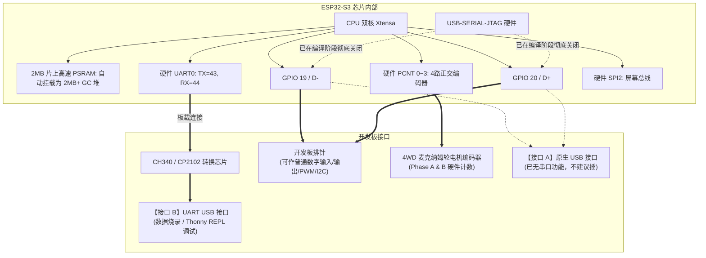

# ESP32-S3 LVGL 8.3 + PSRAM (N8R8 / N8R16 / N8R2 三硬件适配) + 4路PCNT硬件编码器 定制固件说明文档

本文档是定制版 `lv_micropython` 固件的技术规格说明、硬件接线图解、烧录流程及开发指南。

---

## 固件核心参数与增强特性

| 项目 | 参数 / 规格 | 说明 |
| :--- | :--- | :--- |
| **基础内核** | `lv_micropython` (release/v8) | 对齐官方稳定版，MicroPython v1.19.1 内核 |
| **全硬件 PSRAM 适配** | **N8R8 (8MB OPI)**：`CONFIG_SPIRAM_MODE_OCT=y`<br>**N8R16 (16MB OPI)**：`CONFIG_SPIRAM_MODE_OCT=y`<br>**N8R2 (2MB QSPI)**：`CONFIG_SPIRAM_MODE_QUAD=y` | 提供三套专属固件：<br>1. **N8R8 版**：满血挂载 **8.2MB (8,194,064 Bytes)** 独立堆空间；<br>2. **N8R16 版**：满血挂载 **16MB (16,777,216 Bytes)** 独立堆空间；<br>3. **N8R2 版**：满血挂载 **2.0MB (2,049,088 Bytes)** 独立堆空间，彻底根治 `MemoryError` |
| **GUI 引擎** | **LVGL v8.3.x** | 原生 C 绑定，语法 **100% 兼容 [sim.lvgl.io](https://sim.lvgl.io)** |
| **硬件编码器** | **4路硬件 PCNT 编码器** (`machine.Encoder`) | 内置 PCNT 硬件单元（Unit 0~3），4倍频正交解码，64位连续累加，专为 4WD 麦克纳姆轮高速电机设计 |
| **特殊引脚支持** | **GPIO 46 作为 PCNT 输入** | 适配 GPIO46 (Input-only Strapping 引脚)，GPIO Matrix 硬件直通计数，无需软件中断 |
| **中断越界修复** | **全量 GPIO 0~48 软硬件中断** | 修复官方经典 40 引脚数组限制，扩展至 `SOC_GPIO_PIN_COUNT=49`，彻底消除 GPIO >= 40 (`Pin.irq()`) 踩踏 VFS 崩溃 Bug |
| **适用芯片** | **ESP32-S3** (Dual-Core Xtensa LX7) | 完美支持各类 ESP32-S3 双 USB 接口开发板（覆盖 N8R8、N8R16、N16R8 及 N8R2 等全系型号） |
| **Flash 规格** | 8MB Flash (DIO, 80MHz) | 向下兼容 16MB Flash 开发板 |
| **分区布局** | Factory: 3008 KB (`0x2F0000`)<br>VFS: 5120 KB (`0x500000`) | 固件体积约 2.0MB，预留充裕空间，提供 5MB 大容量文件存储空间 |
| **内置屏幕驱动** | `ili9XXX` 驱动框架 | 内置 **ST7789, GC9A01, ILI9341, ILI9488, ST7735** |
| **核心释放** | **释放 GPIO19 (D-)、GPIO20 (D+)** | 彻底关闭原生 USB-SERIAL-JTAG 与 USBDEV，释放为纯粹普通 GPIO |
| **控制台端口** | **物理硬件 UART0** (波特率 115200) | 映射到 GPIO43(TX) 与 GPIO44(RX)，由板载 CH340 / CP2102 芯片引出 |

---

## 硬件架构与双 USB 接口定义

ESP32-S3 常见开发板通常配备两个 Type-C 接口。本固件针对硬件外设进行了重新分配：



### 接口使用规则：

> [!IMPORTANT]
> 1. **交互与烧录必须使用【接口 B (UART 口)】**：所有固件烧录、串口输出、Thonny IDE 编程必须插在带有独立 USB 转串口芯片（CH340 / CP2102）的接口上。
> 2. **【接口 A (原生 USB 口)】已无串口响应**：因为 GPIO19/20 已被解绑并配置为普通数字 GPIO，将数据线插入接口 A 电脑将不会识别出任何串口（显示未知设备或无反应），这属于正常现象。
> 3. **引脚冲突规避**：开发板排针上的 `GPIO43` 与 `GPIO44` 为当前系统控制台专用脚，请勿将传感器、屏幕片选等外部电路连接到这两个引脚。

---

## 一键烧录指南 (Mac / Windows)

### 交付包目录结构：

```text
├── flash_auto.py               # 核心全自动智能烧录器 (支持 eFuse 硬件识别 + 自动匹配 + 连机自检)
├── flash_oneclick_mac.command  # Mac 用户双击运行 (全自动智能烧录，无需用户选择)
├── flash_oneclick_mac.sh       # Mac 终端全自动运行脚本
├── flash_oneclick.bat          # Windows 双击运行批处理 (内置自动硬件探测，零手动干预)
├── firmware_N8R8.bin           # 适配 N8R8 / N16R8 (8MB Octal/OPI PSRAM，满血 8.2MB 运存)
├── firmware_N8R16.bin          # 适配 N8R16 / N16R16 (16MB Octal/OPI PSRAM，满血 16MB 运存)
├── firmware_N8R2.bin           # 适配 N8R2 (2MB Quad/QSPI PSRAM，满血 2.0MB 运存)
├── firmware.bin                # 默认固件副本 (指向 N8R8)
├── readme.txt                  # 简易操作说明
├── test_encoder.py             # 4路硬件PCNT编码器与中断测试脚本
├── test_gpio.py                # GPIO19/20 功能验证脚本
├── test_lvgl_screen.py         # 最简 LVGL 8.3 屏幕测试脚本
└── drivers/                    # CH340 / CP2102 串口驱动
```

### 烧录操作步骤 (无需手动选型)：
1. **连接硬件**：用数据线将电脑连接至开发板的 **UART 接口**（带有 CH340 / CP2102 芯片一侧）。
2. **关闭占用软件**：烧录前**务必关闭 Thonny IDE、串口助手**等软件，避免串口被独占。
3. **双击运行脚本 (全流程自动)**：
   - **Mac 用户**：双击运行 `flash_oneclick_mac.command`（或终端运行 `./flash_oneclick_mac.sh`）。
   - **Windows 用户**：双击运行 `flash_oneclick.bat`。
4. **全自动执行过程**：
   - 脚本会自动扫描串口，并通过芯片底层 **eFuse 自动探测** PSRAM 规格（8MB / 16MB / 2MB）；
   - 自动匹配并全片擦除烧录对应的满血固件；
   - 烧录后自动连机校验 REPL 并打印当前可用 PSRAM 堆空间，无需任何用户交互。

---

## 验证与测试代码

### 1. 验证 2MB PSRAM 堆内存 (`gc.mem_free()`)

```python
import gc
print("当前 MicroPython 可用内存 (Bytes):", gc.mem_free())
# 预期输出: 8190000+ (8.2MB 以上，较之前 140KB 暴涨 58 倍！)
```

### 2. 4路硬件 PCNT 编码器与 GPIO 中断测试 (`test_encoder.py`)

```python
import time
from machine import Pin, Encoder

print("=== ESP32-S3 硬件特性与PCNT编码器自检 ===")

# 1. 验证 GPIO >= 40 中断注册安全 (彻底杜绝 VFS 越界踩踏 Bug)
p45 = Pin(45, Pin.IN, Pin.PULL_UP)
p45.irq(trigger=Pin.IRQ_FALLING, handler=lambda t: None)
print("GPIO 45 中断注册成功！无内存踩踏。")

# 2. 初始化 4WD 底盘 4 路硬件正交编码器 (Unit 0~3)
enc0 = Encoder(0, 12, 13, phases=4, filter_ns=1000)
enc1 = Encoder(1, 46,  9, phases=4, filter_ns=1000)
enc2 = Encoder(2, 10, 11, phases=4, filter_ns=1000)
enc3 = Encoder(3, 14, 21, phases=4, filter_ns=1000)

print(f"电机 0 计数值: {enc0.value()}")
print(f"电机 1 计数值: {enc1.value()}")
print(f"电机 2 计数值: {enc2.value()}")
print(f"电机 3 计数值: {enc3.value()}")

enc0.value(0)
print("4路硬件编码器就绪！")
```

### 3. GPIO19 / 20 普通功能测试 (`test_gpio.py`)

```python
import time
from machine import Pin

p19 = Pin(19, Pin.OUT)
p20 = Pin(20, Pin.OUT)
p19.value(1)
p20.value(0)
time.sleep_ms(200)
print(f"GPIO19={p19.value()}, GPIO20={p20.value()}")
```

### 4. 最简 LVGL 8.3 屏幕测试 (`test_lvgl_screen.py`)

```python
import lvgl as lv
from ili9XXX import st7789

lv.init()
disp = st7789(
    miso=-1, mosi=11, clk=12, cs=10, dc=13, rst=14, backlight=15,
    width=240, height=240, rot=st7789.ROTATION_0, spihost=1
)
scr = lv.scr_act()
label = lv.label(scr)
label.set_text("ESP32-S3 LVGL 8.3 + PSRAM + PCNT")
label.center()
```
