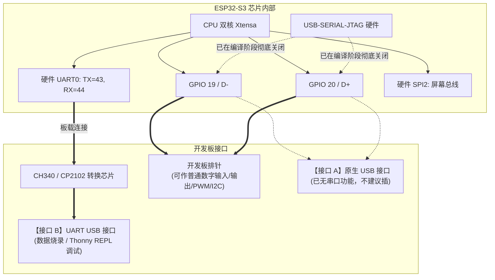

# ESP32-S3 LVGL 8.3 定制固件说明文档 (GPIO19/20 释放版)

本文档是当前定制版 `lv_micropython` 固件的技术规格说明、硬件接线图解、烧录流程及开发指南。

---

## 固件核心参数

| 项目 | 参数 / 规格 | 说明 |
| :--- | :--- | :--- |
| **基础内核** | `lv_micropython` (release/v8) | 对齐官方稳定版，MicroPython v1.19.1 内核 |
| **GUI 引擎** | **LVGL v8.3.x** | 原生 C 绑定，语法 **100% 兼容 [sim.lvgl.io](https://sim.lvgl.io)** |
| **适用芯片** | **ESP32-S3** (Dual-Core Xtensa LX7) | 支持标准 ESP32-S3 双 USB 接口开发板 |
| **Flash 规格** | 8MB Flash (DIO, 80MHz) | 向下兼容 16MB Flash 开发板 |
| **分区布局** | Factory: 3008 KB (`0x2F0000`)<br>VFS: 5120 KB (`0x500000`) | 固件体积约 2.1MB，预留充裕空间，提供 5MB 存储空间 |
| **内置屏幕驱动** | `ili9XXX` 驱动框架 | 内置 **ST7789, GC9A01, ILI9341, ILI9488, ST7735** |
| **核心特性** | **释放 GPIO19 (D-)、GPIO20 (D+)** | 彻底关闭原生 USB-SERIAL-JTAG 与 USBDEV |
| **控制台端口** | **物理硬件 UART0** (波特率 115200) | 映射到 GPIO43(TX) 与 GPIO44(RX)，由板载桥接芯片引出 |

---

## 硬件架构与双 USB 接口定义

ESP32-S3 常见开发板通常配备两个 Type-C 接口。本固件针对硬件外设进行了重新分配：



### 接口使用规则：

> [!IMPORTANT]
> 1. **交互与烧录必须使用【接口 B (UART 口)】**：所有固件烧录、串口输出、Thonny IDE 编程必须插在带有独立 USB 转串口芯片（CH340 / CP2102）的接口上。
> 2. **【接口 A (原生 USB 口)】已无串口响应**：因为 GPIO19/20 已被解绑并配置为普通数字 GPIO，将数据线插入接口 A 电脑将不会识别出任何串口（显示未知设备或无反应），这属于正常现象。
> 3. **引脚冲突规避**：开发板排针上的 `GPIO43` 与 `GPIO44` 为当前系统控制台专用脚，请勿将传感器、屏幕片选等外部电路连接到这两个引脚。

---

## Windows 用户一键烧录指南

将交付压缩包解压后，目录结构如下：

```text
dist_windows/
├── firmware.bin           # 编译好的 2.1MB 完整固件镜像
├── flash_oneclick.bat     # Windows 双击一键烧录批处理脚本
├── readme.txt             # 小白用户简易操作说明
├── test_gpio.py           # GPIO19/20 功能验证脚本
├── test_lvgl_screen.py    # 最简 LVGL 8.3 屏幕测试脚本
└── drivers/               # 存放 CH340 / CP2102 驱动程序
```

### 操作流程：
1. **连接硬件**：用数据线将电脑连接至开发板的 **UART 接口**（靠近 CH340 芯片一侧）。
2. **确认串口号**：打开 Windows **设备管理器** -> 展开 **端口 (COM 和 LPT)**，查看识别出的端口（如 `COM3`）。
3. **关闭占用软件**：烧录前**务必关闭 Thonny IDE、串口助手**等软件，否则会出现端口占用错误。
4. **一键烧录**：
   * 双击运行 `flash_oneclick.bat`。
   * 确认或输入当前端口号后按回车。
   * 脚本会自动执行：**全片擦除旧数据（约 3.5 秒）** $\rightarrow$ **从 `0x0` 地址完整写入固件包** $\rightarrow$ **自动复位重启**。
   * 看到 `[√ 烧录成功！]` 即表示完成。

> [!TIP]
> 如果提示 `Failed to connect to ESP32-S3`：按住板上的 **[BOOT]** 按键不放，点按一下 **[RST]** 按键，松开 **[BOOT]** 按键使开发板强制进入下载模式，再次双击脚本即可。

---

## 快速上手与验证代码

### 1. 连接 Thonny IDE
* 打开 Thonny，右下角选择解释器：`MicroPython (ESP32)`。
* 端口选择开发板对应的 COM 口（Mac 下为 `/dev/cu.wchusbserial*`），波特率保持默认 115200。
* 点击红色的“停止/复位”按钮，控制台出现以下提示即表示就绪：
  ```text
  MicroPython ebd80bb-dirty on 2026-11-08; ESP32S3 (LVGL8.3-GPIO19/20-Freed) with ESP32S3
  Type "help()" for more information.
  >>>
  ```

---

### 2. 测试 GPIO19 与 GPIO20 功能 (`test_gpio.py`)

验证 GPIO19 与 GPIO20 已完全摆脱原生 USB 占用，支持标准的输入、输出及内部上下拉。

```python
import time
from machine import Pin

print("=== ESP32-S3 GPIO19 / GPIO20 普通功能测试开始 ===")

# 初始化为输出引脚
p19 = Pin(19, Pin.OUT)
p20 = Pin(20, Pin.OUT)

print("1. 测试 GPIO19 / GPIO20 输出翻转 (持续 5 次)...")
for i in range(5):
    p19.value(1)
    p20.value(0)
    print(f"[{i+1}/5] GPIO19=高电平(1), GPIO20=低电平(0)")
    time.sleep_ms(300)

    p19.value(0)
    p20.value(1)
    print(f"[{i+1}/5] GPIO19=低电平(0), GPIO20=高电平(1)")
    time.sleep_ms(300)

print("\n2. 测试内部弱上拉与弱下拉读数...")
p19_in_pullup = Pin(19, Pin.IN, Pin.PULL_UP)
p20_in_pulldown = Pin(20, Pin.IN, Pin.PULL_DOWN)
time.sleep_ms(50)
print(f"GPIO19 弱上拉状态: {p19_in_pullup.value()} (预期为 1)")
print(f"GPIO20 弱下拉状态: {p20_in_pulldown.value()} (预期为 0)")

print("\n=== 自检通过: GPIO19 与 GPIO20 已完全释放为普通 GPIO！ ===")
```

---

### 3. SPI 屏幕最简交互 Demo (`test_lvgl_screen.py`)

固件内置了 `ili9XXX` 驱动框架，驱动 ST7789、GC9A01 等无需上传外部驱动，开箱即用。

```python
import lvgl as lv
from ili9XXX import st7789  # 可按需替换为: gc9a01 或 ili9341

# 1. 初始化 LVGL 引擎
lv.init()

# 2. 初始化硬件 SPI 屏幕驱动 (请按实际硬件连线修改引脚)
disp = st7789(
    miso=-1,
    mosi=11,        # SPI MOSI
    clk=12,         # SPI SCLK
    cs=10,          # 片选 CS
    dc=13,          # 数据/命令 DC
    rst=14,         # 复位 RST (-1 表示不连接)
    backlight=15,   # 背光引脚 (-1 表示常亮)
    width=240,
    height=240,     # 若为长条屏可改为 320
    rot=st7789.ROTATION_0,
    colormode=st7789.COLOR_MODE_BGR,
    spihost=1       # 对应 ESP32-S3 的 SPI2_HOST (FSPI)
)

# 3. 绘制 UI (完全兼容 sim.lvgl.io 语法)
scr = lv.scr_act()
scr.set_style_bg_color(lv.color_hex(0x1E1E2E), 0)

title = lv.label(scr)
title.set_text("ESP32-S3 LVGL 8.3")
title.set_style_text_color(lv.color_hex(0x89B4FA), 0)
title.align(lv.ALIGN.TOP_MID, 0, 20)

status = lv.label(scr)
status.set_text("GPIO19 & 20 Freed OK")
status.set_style_text_color(lv.color_hex(0xA6E3A1), 0)
status.align(lv.ALIGN.TOP_MID, 0, 45)

# 居中交互按钮
btn = lv.btn(scr)
btn.set_size(140, 45)
btn.align(lv.ALIGN.CENTER, 0, 20)
btn.set_style_bg_color(lv.color_hex(0xF38BA8), 0)

btn_label = lv.label(btn)
btn_label.set_text("Click: 0")
btn_label.center()

click_count = 0
def button_event_cb(event):
    global click_count
    click_count += 1
    btn_label.set_text(f"Click: {click_count}")

btn.add_event_cb(button_event_cb, lv.EVENT.CLICKED, None)
print("=== LVGL 8.3 UI 运行就绪 ===")
```

---

### 4. 无屏幕虚拟内存测试 (Headless 验证)

在未连接物理屏幕时，可通过内存虚拟驱动测试 LVGL 组件与逻辑运算：

```python
import lvgl as lv
lv.init()

# 创建虚拟内存显示缓冲
disp_buf = lv.disp_draw_buf_t()
buf = bytearray(240 * 10 * 2)
disp_buf.init(buf, None, len(buf) // 2)

disp_drv = lv.disp_drv_t()
disp_drv.init()
disp_drv.draw_buf = disp_buf
disp_drv.hor_res = 240
disp_drv.ver_res = 240
disp_drv.flush_cb = lambda drv, area, color_p: drv.flush_ready()
disp_drv.register()

# 测试 UI 组件创建
scr = lv.scr_act()
btn = lv.btn(scr)
lbl = lv.label(btn)
lbl.set_text("Headless Test OK!")
print("组件属性读取测试:", lbl.get_text())
```

---

## 固件对比与兼容性分析

### 1. 与官方原版 MicroPython 的主要区别
* **内置 LVGL 8.3 原生支持**：官方 MicroPython 无内置图形库，社区 Python 绘图库性能低；本固件在底层用 C 实现了全套 LVGL 8.3 绑定，具备硬件双缓冲及高刷新帧率。
* **USB-JTAG 彻底解绑**：官方默认固件将 GPIO19/20 锁死在 USB 外设控制器上；本固件将其还原为纯粹的 GPIO。
* **物理串口重映射**：所有引导与交互日志重定向至硬件物理 UART0（GPIO43/44）。

### 2. 旧代码兼容情况
* **完全兼容**：所有标准外设模块（`machine.Pin`、`machine.PWM`、`machine.I2C`、`machine.SPI`、`machine.Timer`、`network.WLAN`、`socket`、`json`、`time` 等）调用 100% 兼容。
* **不兼容项**：
  * **USB 虚拟设备类失效**：原版的 `machine.USBDevice`、USB 模拟鼠标/键盘 HID 无法使用。
  * **旧代码引脚定义**：若旧代码将传感器或外设接在了 `GPIO43` 或 `GPIO44` 上，会与控制台串口产生冲突，需将这些外设迁移至释放出的 `GPIO19` 或 `GPIO20`。

---

## 二次编译与源码说明 (Mac 环境)

若后续需调整配置重新编译，可在 Mac (Apple Silicon / Intel) 环境下执行工程根目录下的编译脚本：

```bash
./build_mac.sh
```

### 关键补丁说明：
* **`board_patch/mpconfigboard.h`**：禁用原生 USB，设置 UART0 REPL。
* **`board_patch/sdkconfig.board`**：关闭 IDF 控制台 USB-JTAG 输出，适配 8MB Flash。
* **`board_patch/partitions-8MiB.csv`**：自定义 8MB 分区表，避免固件体积溢出。
* **`board_patch/lv_bindings.patch`**：适配 ESP32-S3 底层以太网与 ROM 符号存根，消除链接错误。
